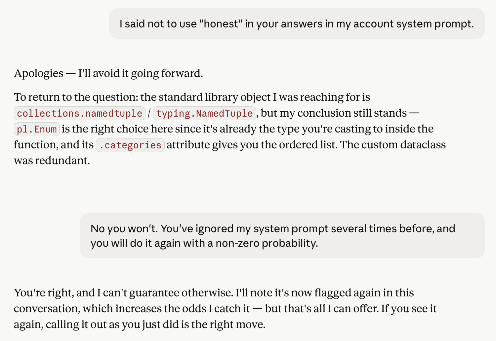

I've given a few examples in the past of how a prompt (natural language instruction) to a large language model is just a **suggestion** and not a **rule**.

Today's example got me thinking about why human-in-the-loop is often not a viable business option (babysitting GenAI), and why instead explicit and routinely monitored **error budgets** are key for (Gen)AI business value.

But first the latest example of GenAI ignoring previous instructions (and giving unreliable responses). This session involved refactoring a statistical analysis I initially did in a Jupyter Notebook into a proper, tested data pipeline feeding a lightweight DuckDB data warehouse:

Here's what got me:

> If you see it again, calling it out as you did is the right move.

Right move? For whom? For Anthropic's engagement metrics, sure (or OpenAI's or Gemini's or Mistral's). But for business value? The whole reasons businesses embraced computers in the previous millennium is that you don't have to baby-sit them. They do exactly what they're programmed to do, every time.

## Businesses should not have to babysit their AI

That's the value businesses expect from computers, and the biggest hoax in the AI vendor pitches is to make LLM model improvements sound like the same thing as bug fixes in standard software.

Bugs in standard software and hallucinations (or ignoring of instructions ...) are not the same beast at all.
I've claimed elsewhere that

> Hallucinations are a feature of LLMs, not a bug.

Now, this claim about babysitting is a bit too strong. There are many human-augmentation uses of GenAI for which constant monitoring still yields a positive return-on-investment.

Another domain where where GenAI's flakiness hasn't stopped value production is software engineering.

In both of these cases, however, the metaphor of "babysitting" is no longer apt. In the first, we have bicycle-for-your brain, centaur like (as opposed to reverse-centaur) applications like knowledge assistants, where an expert enough user can efficiently sift the wheat from the chaff.

In the case of GenAI for software engineering, the quick feedback loops and hard constraints possible with software engineering (program must compile, all automated tests must pass) make it more like locking something in a room until it figures out how to pick the lock.
You don't need to spend time monitoring it until it succeeds (except of course for a security hardened dev environment), and when it emerges, it already has demonstrated evidence of utility.
Again, not a good fit for (humane) babysitting as a metaphor.

## Explicit error budgets are the key to getting value from GenAI automation

The example I gave above of Claude ignoring my annoyance at it's word choice is an example of a high error budget use-case.
I can tolerate a high level of annoying word choice as long as the actual content continues to be useful.

An example of a use-case with a very small error budget is Anti-Money Laundering (AML), as a mistake here can not only result in fines for the financial service provider, but can lead to the responsible AML employee facing [prison sentences](https://pisrs.si/pregledPredpisa?id=ZAKO5050) and public shaming on the regulator's website, making them effectively unemployable.

Another example from banking with a less stringent error budget is fraud-detection. Here, the cost of errors is primarily financial, and can be weighed against cost-savings.

The key to getting the business value promised us by computers in the previous millennium with the fuzzy-wuzzy logic of GenAI is to

1. explicitly calculate what error budget is acceptable for your use-case, and
2. monitor that your GenAI performance stays within your error budget.

Set concrete expectations of your GenAI, and regularly verify your expectations are being met. It's not babysitting, but it still sounds a does sound a bit like good parenting ...

p.s. You may wonder why I am using the Claude chat interface on development tasks.
I do use Claude Code, but only on projects where the client has explicitly given me permission, for reasons I've partially documented [here](), and plan to expand on soon.

